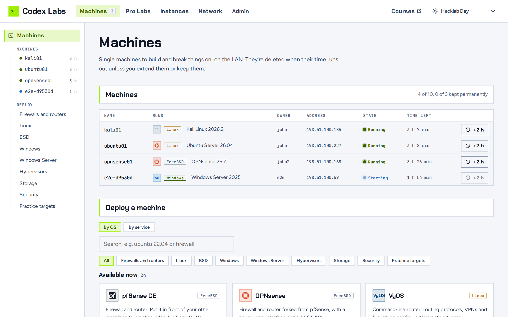
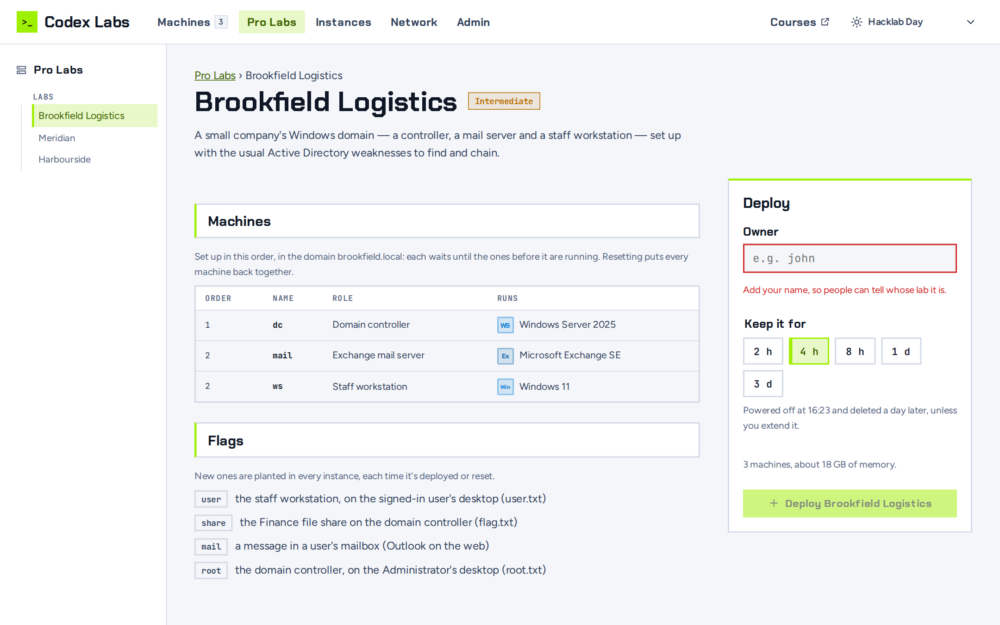
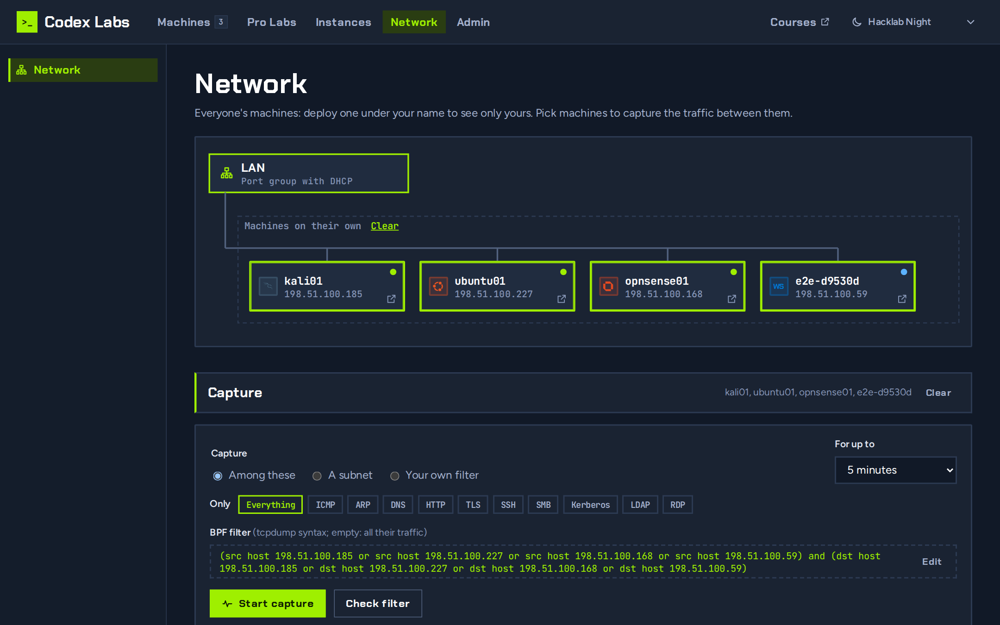

# lab-deploy

A web panel that deploys, resets and tears down Pro Labs (HackTheBox-style networks of vulnerable
machines) on VMware vSphere, for a LAN without internet access. The labs are advertised on the LMS;
lab slugs match its `labs/<slug>.md` pages.

It deploys **single machines** (56 template versions: Ubuntu, Debian, the RHEL family, Fedora,
CachyOS, Kali, Parrot, Windows Server and 11, firewalls and routers, hypervisors, storage appliances and
vulnerable images) with optional extras (web servers and apps, databases, mail, Docker apps, Active
Directory, Exchange, …), and **Pro Labs**: several machines deployed together as one instance, in boot
order, with flags planted in each (Brookfield, an Active Directory domain, is the first). Machines can
be started, stopped, reset, redeployed, extended and destroyed, and reached over SSH, RDP or a browser
console. The admin page shows capacity, every machine, leftover VMs and the job queue. Personal
networks (VPN) and sign-in come later.



| A Pro Lab, ready to deploy | The network, picking machines to capture |
|---|---|
|  |  |

More in [`docs/screenshots/`](docs/screenshots/): the deploy form, a machine's page, the browser console,
Pro Labs, the admin page and the dark theme.

**Guides:** the [Admin guide](docs/admin-guide.md) (running the site, adding machines and Pro Labs) and
the [Developer guide](docs/developer-guide.md) (how it works). Themed HTML copies are in
[`docs/html/`](docs/html/), made with `python3 scripts/docs/build-html.py`.

- [`frontend/`](frontend/): the panel UI (SvelteKit, static build).
- [`backend/`](backend/): the API and job worker (FastAPI, pyVmomi, PostgreSQL with Procrastinate).
  [`backend/templates.yaml`](backend/templates.yaml) lists what can be deployed, and
  [`backend/extras.yaml`](backend/extras.yaml) the extras that can be ticked at deploy.
- [`deploy/`](deploy/): server setup and deployment (Docker Compose, Caddy).
- [`scripts/setup_vcenter.py`](scripts/setup_vcenter.py): prepares vCenter (folders, roles, permissions).
- [`scripts/template/`](scripts/template/): `prepare.sh` and `clean.sh` turn a fresh Linux VM (Ubuntu, Debian,
  Kali, Parrot, CentOS Stream, Rocky, Alma) into a template; `prepare.ps1` and `clean.ps1` do the same for Windows,
  with Cloudbase-Init and sysprep.
- [`docs/setup-vsphere.md`](docs/setup-vsphere.md): the one-off vCenter setup and how to build the
  Ubuntu, Windows Server, and Kali and Parrot templates.
- [`docs/plan.md`](docs/plan.md): the plan: stack, vSphere architecture, features, limitations and phases.

**No sign-in yet:** anyone who can reach the panel can deploy and destroy machines and read their
passwords. Keep it on a trusted network until accounts exist.

## Developing

```sh
# Backend tests, against PostgreSQL and vcsim (VMware's vCenter simulator), in Docker:
docker compose -f backend/compose.test.yaml run --rm --build tests

# Frontend, with /api proxied to an API on localhost:8000:
cd frontend && npm install && npm run dev
```

## Deploying

Once per server, on the server (Ubuntu 22.04/24.04):

```sh
sudo bash deploy/setup-server.sh   # Docker, full-size root volume, /srv/lab-deploy, docker group
```

After that, every push to `main` deploys itself: the GitLab pipeline ([`.gitlab-ci.yml`](.gitlab-ci.yml))
checks and builds the panel and tests the backend, then runs `deploy/deploy.sh` against the server.
The CI/CD variables it needs are listed at the top of that file. A deploy waits for jobs the worker
is running (deploys, resets) to finish, for up to 15 minutes; any it cuts off anyway are marked
failed within a minute or two, and their machines show as errors.

The first deploy creates `/srv/lab-deploy/lab-deploy.env` on the server, with a generated database
password. Fill in its vCenter settings ([`docs/setup-vsphere.md`](docs/setup-vsphere.md)) before
deploying machines.

To deploy by hand from a development machine instead:

```sh
DEPLOY_HOST=192.0.2.10 SSH_KEY=~/.ssh/lab-deploy deploy/deploy.sh
```

The panel is served over HTTPS by Caddy with its own internal CA, the same as the LMS. Browsers warn
until they trust its root certificate, which you can export with:

```sh
docker compose -f /srv/lab-deploy/compose.yaml exec caddy cat /data/caddy/pki/authorities/local/root.crt
```

### Backups

The `backup` service dumps the database when it starts and then once a day, to
`/srv/lab-deploy/backups/labdeploy-<date>-<time>.sql.gz`, and deletes dumps older than 14 days. The
database holds every machine's password and settings; without it, the panel no longer knows the VMs
in vCenter. Copy the folder somewhere else as well, if you can.

To restore one (it replaces what's in the database), with the workers stopped so no job runs:

```sh
cd /srv/lab-deploy
docker compose stop worker sweeper
gunzip -c backups/labdeploy-<date>-<time>.sql.gz | docker compose exec -T postgres psql -q -U labdeploy labdeploy
docker compose start worker sweeper
```

## Templates and testing

The machines' templates are built unattended with Packer (`packer/build.sh <template>`), from ISOs
`scripts/isos/fetch.sh` puts on the datastore, online or from a carried-in media folder offline.
`scripts/e2e/run.py` then deploys real machines through the panel and checks every extra works. The
runbook: [docs/build-templates.md](docs/build-templates.md); by hand: [docs/setup-vsphere.md](docs/setup-vsphere.md).
On a network without internet, one script installs the panel and builds the templates from a bundle
made beforehand: [docs/offline-install.md](docs/offline-install.md).

## Conventions

- Example addresses use documentation ranges (192.0.2.0/24, 198.51.100.0/24, 203.0.113.0/24) and
  `.example` domains. Real hostnames, IPs and keys stay out of the repository.
- Every change is committed and pushed to `main`, which deploys it.
