# Screenshots

The panel as it looked on 2026-10-30, running in the test lab. Addresses are shown in the
documentation range (198.51.100.x) rather than the lab's own. The panel has light and dark themes,
among others (the theme menu, top right).

## Machines

Single machines, each with its owner, address and time left, and the catalogue to deploy from.

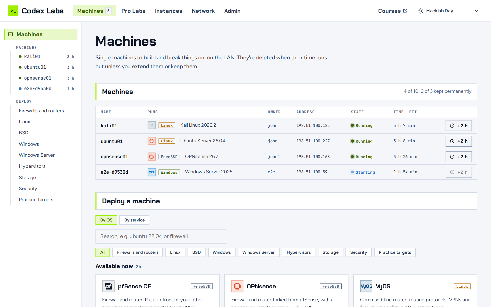

The catalogue, by operating system or by service, with a search box and categories.

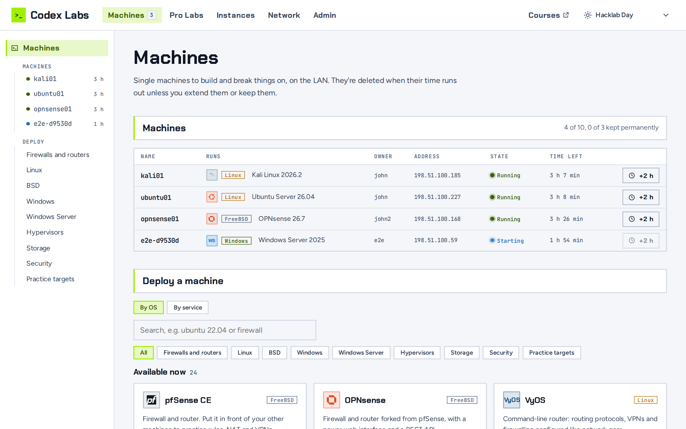

Deploying a template: pick a version and the extras to set up on first boot. The summary shows what it
uses and whether there's room for it.

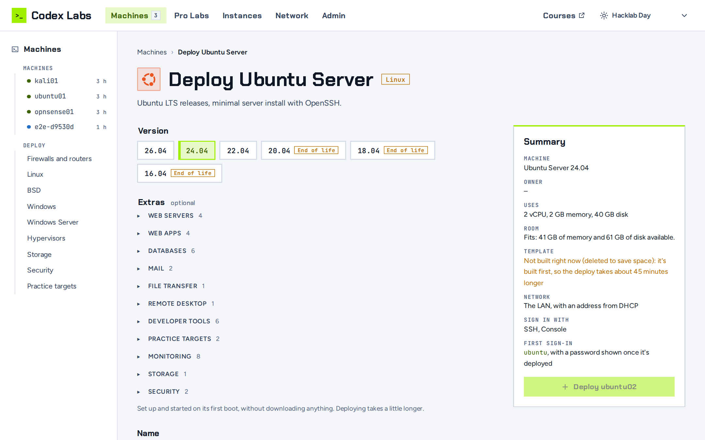

A machine's page: its address, size, owner and template, how to sign in (password, SSH, Remote
Desktop with an .rdp file, or the browser console), and what's happened to it.

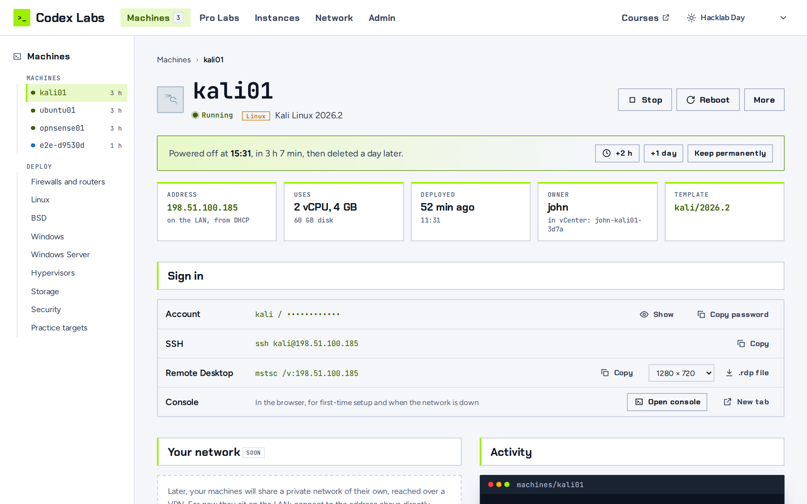

The browser console, for first-time setup or when the network is down (here a Windows Server machine
applying its settings on first boot).

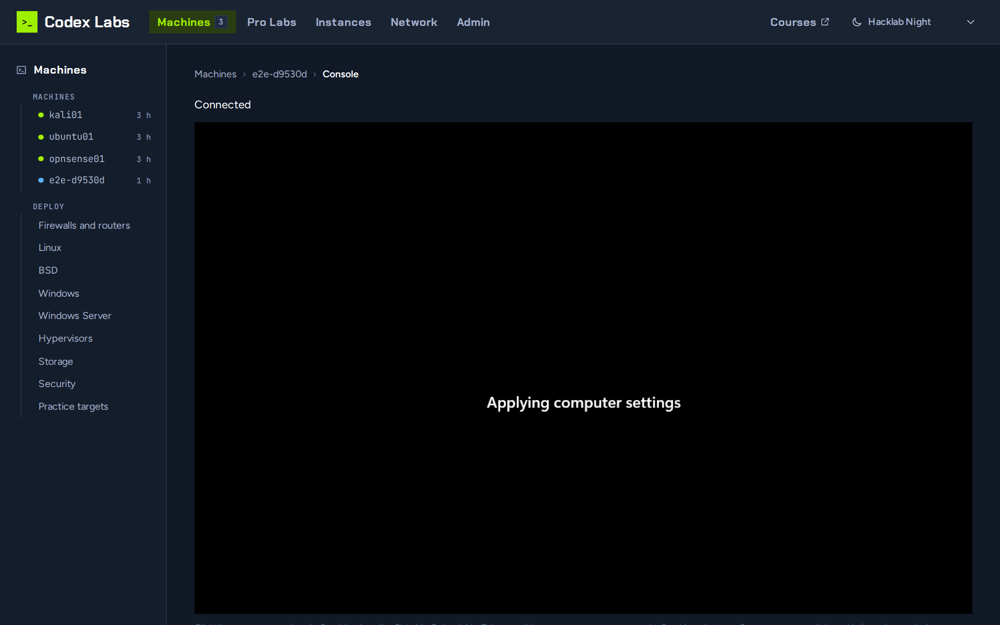

The same Machines page in the dark theme (Hacklab Night).

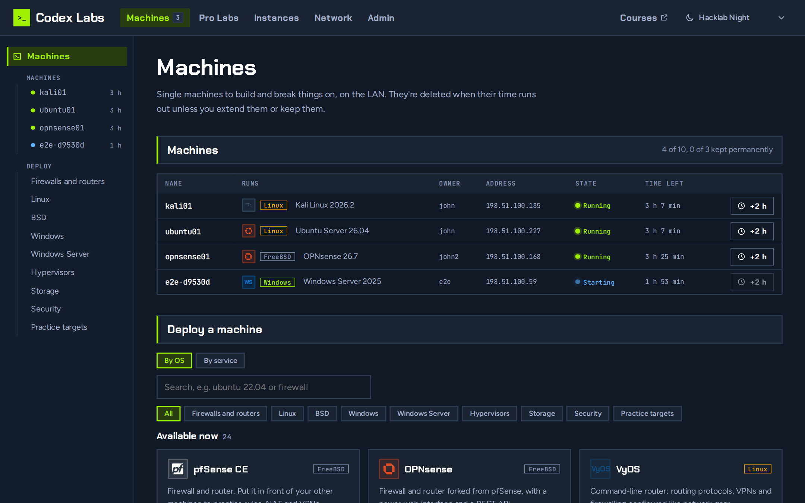

## Pro Labs

Networks of vulnerable machines deployed together as one instance, in order, with flags.

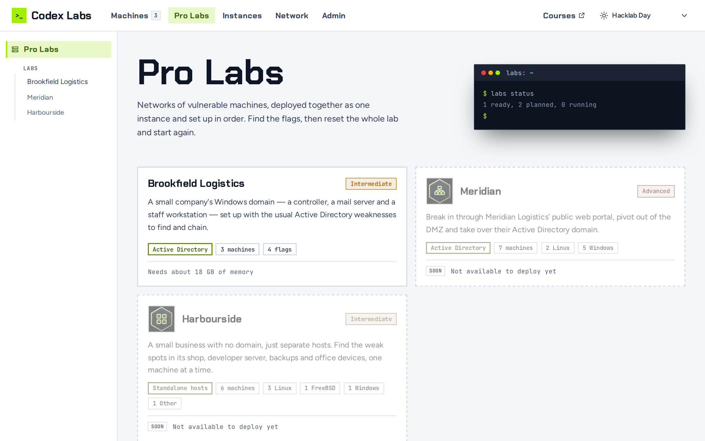

A lab's page: its machines in boot order, the flags planted in every instance, and Deploy.

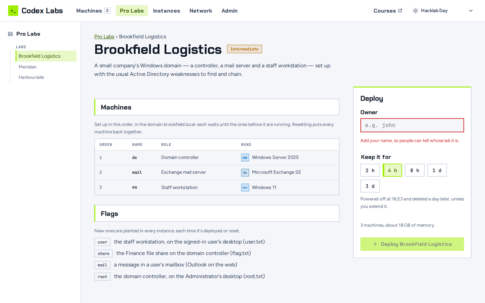

## Network and packet capture

Your machines drawn on the network. Select some to capture the traffic between them, across a subnet,
or with your own BPF filter.

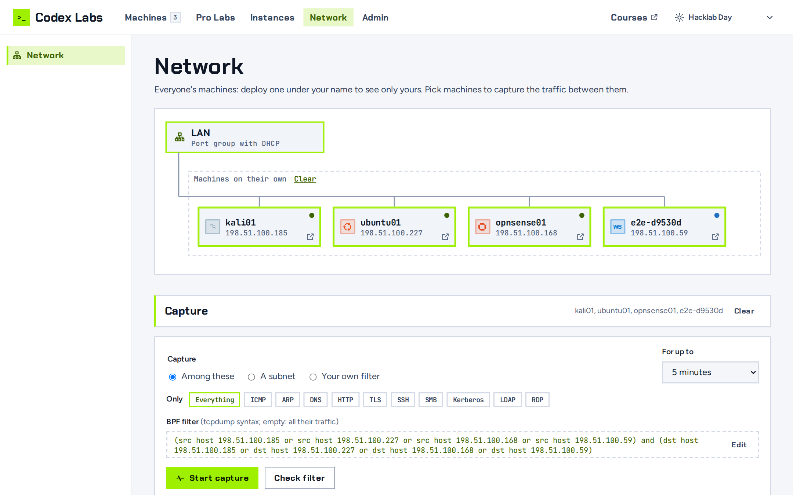

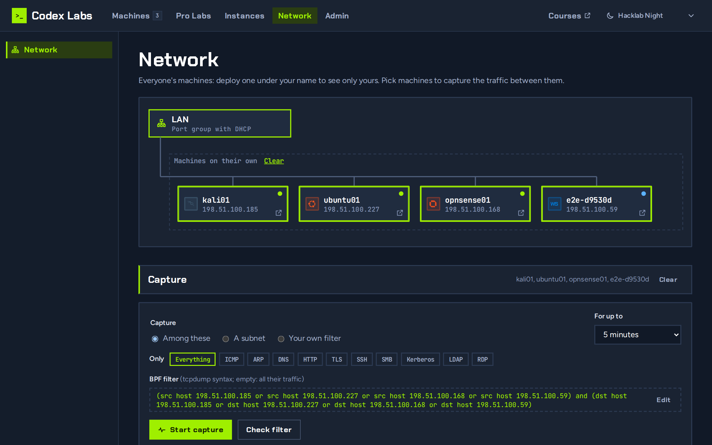

## Admin

The cluster's memory, CPU and storage, then every machine, leftover VMs, the job queue, templates and the
packet capture appliance.

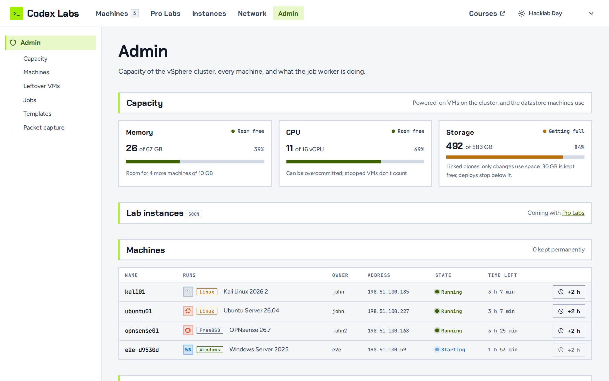
